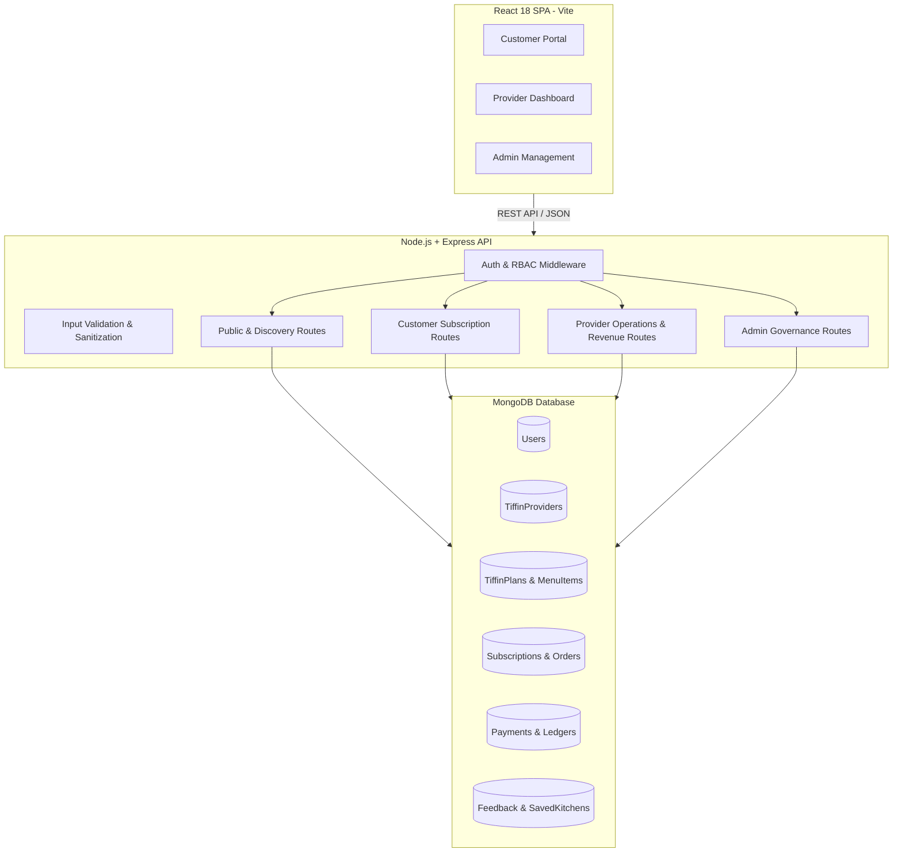

# 🍱 TiffinHub — Full-Stack Tiffin & Meal Subscription Platform

<div align="center">

[](https://reactjs.org/)
[](https://vitejs.dev/)
[](https://nodejs.org/)
[](https://expressjs.com/)
[](https://www.mongodb.com/)
[](https://tailwindcss.com/)
[](https://jwt.io/)

**A modern, production-grade MERN web platform connecting local home-kitchen tiffin providers with daily meal subscribers.**

[Features](#-key-features) • [Architecture](#-system-architecture) • [Tech Stack](#-technology-stack) • [Quick Start](#-getting-started) • [API Reference](#-api-endpoints-overview) • [License](#-license)

</div>

---

## 📖 Overview

**TiffinHub** eliminates the operational friction experienced by local tiffin and mess service providers who rely on phone calls and paper notebooks. At the same time, it empowers customers (students, working professionals, and families) to discover verified home-cooked kitchens, customize recurring meal plans, manage delivery schedules, and make payments with zero hassle.

The application implements a robust **Role-Based Access Control (RBAC)** architecture supporting three distinct user types:
1. **Customers:** Discover kitchens, book flexible weekly/monthly meal subscriptions, manage delivery addresses, and leave reviews.
2. **Kitchen Providers:** Manage daily food dispatches, plan weekly menus with strict dietary enforcement, track real-time revenue analytics, and configure operational hours.
3. **Platform Administrators:** Verify new kitchen registrations, oversee user accounts, and maintain platform listing standards.

---

## ✨ Key Features

### 🥗 1. Customer Discovery & Subscription Engine
- **Dietary & Location Filtering:** Browse kitchens filtered by city, rating, and food preference (**Pure Veg** vs. **Non-Veg / Both**).
- **Flexible Subscription Plans:** Subscribe to Weekly (7-day), Monthly (30-day), or custom duration meal packages across multiple meal slots (**Breakfast, Lunch, Dinner, All Meals**).
- **Automated Operational Cutoff Protection:** Kitchen-specific daily cutoff enforcement (e.g., 09:30 AM for lunch, 04:30 PM for dinner). If a customer orders after prep hours, the schedule automatically locks and rolls over to the next day to prevent booking conflicts.
- **Saved Kitchens (Bookmarks):** One-click favorite kitchen bookmarking for instant access from the customer dashboard.
- **Address Book Manager:** Save multiple tagged delivery locations (`Home`, `Office`, `Other`) with automatic primary address selection.
- **Direct 1-Click Checkout:** Streamlined, secure direct checkout creating verified payment ledgers and instant activation.
- **Customer Ratings & Feedback:** Review meal quality and leave star ratings that dynamically update kitchen reputation scores.

### 👨‍🍳 2. Provider Management Portal
- **Live Dispatch Dashboard:** Real-time visibility into today's active meal dispatches, upcoming deliveries, and customer orders.
- **Cascading Dietary Restriction Rules:** Pure Veg providers are strictly restricted from publishing non-veg meal plans or items across their entire dashboard, eliminating data entry errors.
- **Weekly Meal Planner:** Organize and update revolving menu items for all 7 days across Breakfast, Lunch, and Dinner.
- **Revenue & Payment Analytics:** Track Total Revenue, Active Paid Subscriptions, and Average Plan Value (**AOV**) with sub-100ms query aggregation.
- **Operational Controls:** Toggle instant auto-acceptance, pause kitchen orders during peak capacity, and set custom order cutoff times.

### 🛡️ 3. Admin Governance & Security
- **Kitchen Verification Pipeline:** Review provider FSSAI credentials, business details, and approve/reject kitchen listings.
- **User & Provider Management:** Platform-wide oversight of active, suspended, or pending accounts.
- **Immutable Purchase Snapshots:** Plans and prices are snapshotted in MongoDB at the time of subscription purchase to preserve historical contracts regardless of future menu or price edits.
- **Multi-Role RBAC:** Secure token-based authentication (JWT + bcrypt) with role-guard middleware (`authenticate`, `isProvider`, `isAdmin`).

---

## 🏗️ System Architecture



---

## 🛠️ Technology Stack

| Layer | Technologies |
|---|---|
| **Frontend** | React 18, Vite 6, Tailwind CSS, Lucide React, Context API, Axios |
| **Backend** | Node.js (v18+), Express.js (v4), ES Modules (`import/export`) |
| **Database** | MongoDB with Mongoose ODM (Compound Indexing, Validation Hooks) |
| **Authentication** | JSON Web Tokens (`jsonwebtoken`), Password Hashing (`bcryptjs`) |
| **Image Hosting** | Cloudinary API (optional / extensible for kitchen profile photos) |
| **Dev Tools** | ESLint, Postman, Git / GitHub |

---

## 📁 Repository Structure

```text
Tiffin Service/
├── backend/
│   ├── src/
│   │   ├── config/              # Database connection & Cloudinary setup
│   │   ├── controllers/         # Business logic handlers (Auth, Subscriptions, Payments, etc.)
│   │   ├── middleware/          # JWT authentication, role guards (isProvider, isAdmin)
│   │   ├── models/              # Mongoose schemas (User, Provider, Plan, Subscription, Payment, etc.)
│   │   ├── routes/              # Express REST API routes
│   │   ├── scripts/             # Admin seeding & migration utilities
│   │   ├── utils/               # Error handling, validators, JWT utilities
│   │   ├── app.js               # Express application config & middleware
│   │   └── server.js            # Server entry point
│   ├── .env.example             # Backend environment template
│   └── package.json
│
├── frontend/
│   ├── public/                  # Static assets & brand logos
│   ├── src/
│   │   ├── assets/              # Images and icons
│   │   ├── components/          # Reusable UI components & modals
│   │   │   ├── customer/        # SubscribeModal, checkout, address book
│   │   │   └── provider/        # Payments, WeeklyMenu, TiffinPlans, Feedback, Orders, etc.
│   │   ├── context/             # AuthContext & user state provider
│   │   ├── pages/               # Main route views (CustomerDashboard, ProviderDashboard, Admin)
│   │   ├── services/            # Axios API client with interceptors
│   │   ├── utils/               # Client-side form & input validators
│   │   ├── App.jsx              # Main React route tree
│   │   └── main.jsx             # Client DOM entry
│   ├── index.html
│   ├── vite.config.js
│   └── package.json
│
├── .gitignore                   # Root ignore rules (node_modules, .env, scratch files)
└── README.md                    # Project documentation
```

---

## 🚀 Getting Started

Follow these steps to set up and run TiffinHub locally on your machine.

### Prerequisites
- **Node.js**: `v18.0.0` or higher ([Download Node.js](https://nodejs.org/))
- **MongoDB**: Local MongoDB instance running on `mongodb://127.0.0.1:27017` or a MongoDB Atlas URI ([Download MongoDB Community](https://www.mongodb.com/try/download/community-edition))
- **Git**: Installed on your system

---

### 1. Clone the Repository
```bash
git clone https://github.com/your-username/tiffin-service-platform.git
cd tiffin-service-platform
```

---

### 2. Backend Setup
1. Navigate to the `backend/` directory:
   ```bash
   cd backend
   ```
2. Install dependencies:
   ```bash
   npm install
   ```
3. Create your `.env` file based on `.env.example`:
   ```bash
   cp .env.example .env
   ```
4. Verify your `.env` values:
   ```env
   PORT=5000
   NODE_ENV=development
   MONGODB_URI=mongodb://127.0.0.1:27017/tiffin_service
   CLIENT_URL=http://localhost:5173
   JWT_SECRET=your_super_secret_jwt_key_here
   JWT_EXPIRES_IN=7d

   ADMIN_NAME="System Administrator"
   ADMIN_EMAIL=admin@tiffinservice.com
   ADMIN_PHONE=9999999999
   ADMIN_PASSWORD=AdminPassword123!
   ADMIN_REGISTRATION_SECRET=admin_secret_key_2026
   ```
5. *(Optional)* Seed the initial System Administrator:
   ```bash
   npm run seed:admin
   ```
6. Start the backend development server:
   ```bash
   npm run dev
   ```
   > 🚀 Backend server running on: `http://localhost:5000`

---

### 3. Frontend Setup
1. Open a new terminal window and navigate to `frontend/`:
   ```bash
   cd frontend
   ```
2. Install dependencies:
   ```bash
   npm install
   ```
3. Start the Vite development server:
   ```bash
   npm run dev
   ```
   > 💻 Frontend application running on: `http://localhost:5173`

---

## 📡 API Endpoints Overview

### Authentication (`/api/auth`)
| Method | Endpoint | Access | Description |
|---|---|---|---|
| `POST` | `/api/customer/auth/register` | Public | Register new customer account |
| `POST` | `/api/customer/auth/login` | Public | Authenticate customer & return JWT |
| `POST` | `/api/provider/auth/register` | Public | Register new kitchen provider |
| `POST` | `/api/provider/auth/login` | Public | Authenticate provider & return JWT |
| `GET`  | `/api/auth/me` | Private | Retrieve authenticated user profile |

### Customer Subscriptions & Discovery
| Method | Endpoint | Access | Description |
|---|---|---|---|
| `GET`  | `/api/kitchens` | Public | Discover active, verified kitchens with filters |
| `GET`  | `/api/kitchens/:id` | Public | Retrieve kitchen details, menu, and plans |
| `POST` | `/api/customer/subscriptions` | Customer | Subscribe to a plan with cutoff validation |
| `GET`  | `/api/customer/subscriptions` | Customer | Fetch current customer subscriptions |
| `GET`  | `/api/customer/saved-kitchens` | Customer | List saved favorite kitchens |
| `POST` | `/api/customer/saved-kitchens/:id`| Customer | Bookmark/unbookmark favorite kitchen |

### Provider Dashboard & Operations
| Method | Endpoint | Access | Description |
|---|---|---|---|
| `GET`  | `/api/provider/plans` | Provider | Fetch provider's active/inactive plans |
| `POST` | `/api/provider/plans` | Provider | Create new plan (enforces dietary rules) |
| `GET`  | `/api/provider/weekly-menu` | Provider | View 7-day revolving menu items |
| `PUT`  | `/api/provider/weekly-menu` | Provider | Update daily meal items |
| `GET`  | `/api/provider/orders` | Provider | View real-time meal orders & statuses |
| `GET`  | `/api/provider/payments` | Provider | Live revenue metrics & transaction ledger |
| `PATCH`| `/api/provider/settings` | Provider | Update operating hours & cutoff times |

---

## 🔒 Security Practices

- **Zero Hardcoded Secrets:** Sensitive keys, JWT credentials, and database URIs are isolated strictly via `.env` files.
- **Database Sanitization & Indexing:** Strict Mongoose validations prevent malformed writes; compound indexes protect analytical queries from slow full-table scans.
- **Safe Password Storage:** Salted and hashed using `bcryptjs` with salt rounds set to 10.
- **Client Route Guards:** Dynamic React context redirects unauthenticated visitors and verifies permissions per route.

---

## 📄 License

This project is licensed under the [MIT License](LICENSE).  
Developed with ❤️ by **Manmit**.
